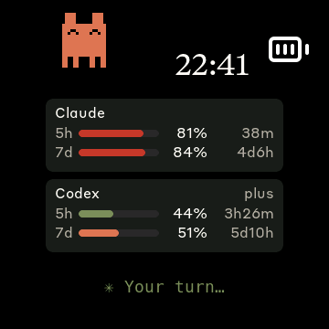
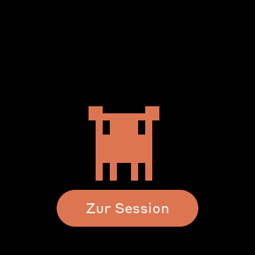
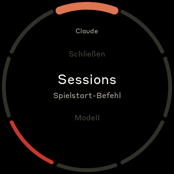
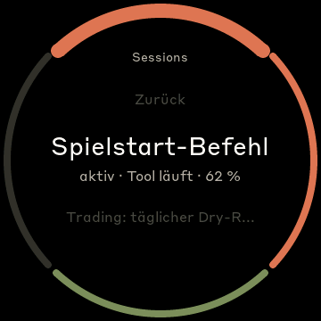
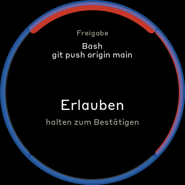
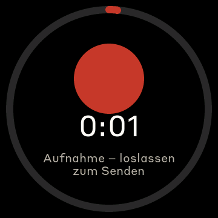
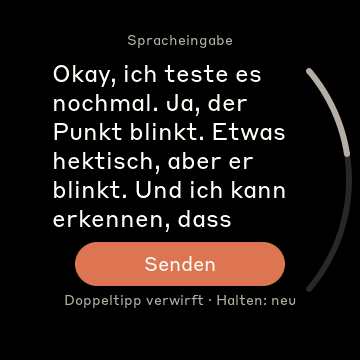
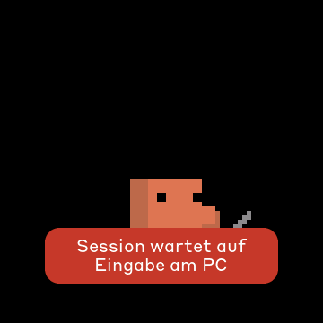

# AI Assistant Knob

Ein **Waveshare ESP32-S3 Knob-1.8** als physische Steuerzentrale für Claude Code, in der CLI
und in der Desktop-App. Der runde Drehregler zeigt die Limits und was Claude gerade tut. Auf
ihm beantwortest du Rückfragen und Freigaben, wechselst Sessions, stellst Modell und Reasoning
ein und sprichst Prompts per Push-to-talk ein.

Basis ist [AI_Limitmeter](https://github.com/SirTobi88/AI_Limitmeter), ein Fork von
[Clawdmeter](https://github.com/HermannBjorgvin/Clawdmeter) von Hermann Björgvin. Von dort
stammen der Knob-1.8-Port, der BLE-Dienst, die Limit-Anzeige mit Clawd, der Simulator und der
Daemon. Dieses Projekt macht aus der Anzeige ein Eingabegerät:

- **Rückfragen und Freigaben am Knob:** Bash-Freigaben, `AskUserQuestion` und Pläne erscheinen
  als Ring-Menü mit pulsierendem blauem Rahmen. Drehen wählt, Tippen bestätigt. Gefährliche
  Optionen (`git push`, `rm -rf`, `sudo` …) gelten nur, wenn du hältst, bis sich der Ring
  gefüllt hat. Ohne Antwort nach 30 s oder mit „Am Rechner“ übernimmt der normale Dialog.
- **Sessions steuern:** Liste aller laufenden Sessions mit den Titeln aus der App-Sidebar,
  sortiert nach letzter Aktivität. Ein Tipp holt die Session auch in der Desktop-App nach vorn.
  Modell, Reasoning, Plan-Modus, Fast und Stopp gehen direkt in die Session.
- **Spracheingabe:** Halten, überall und bis zu 2 Minuten, nimmt über das eingebaute Mikrofon
  auf. Whisper transkribiert lokal auf dem Mac. Der Text lässt sich am Knob lesen und abschicken,
  verwerfen oder zum Bearbeiten ins Eingabefeld der Session legen.
- **„Zur Session“:** Meldet eine Session „needs you“ oder „your turn“, spielt Clawd die
  Animation und bietet nach 5 s einen Button an, der direkt in diese Session springt.
- **Rückmeldung bei Fehlern:** Kommt ein Befehl nicht an, zeigt der Knob kurz, warum, zum
  Beispiel „Session wartet auf Eingabe am PC“, statt stumm zu bleiben.
- **Limits wie beim Limitmeter:** Claude und Codex, 5-Stunden- und Wochenfenster, Uhr und Clawd
  in der Ecke. Die Claude-Werte liefern die Sessions selbst, ohne eigene API-Abfrage.

| Übersicht | Clawd mit „Zur Session“ | Hauptmenü | Sessions |
| :---: | :---: | :---: | :---: |
|  |  |  |  |

| Freigabe | Aufnahme | Transkript | Hinweis |
| :---: | :---: | :---: | :---: |
|  |  |  |  |

*Screenshots aus dem Simulator (360×360, rund wie der Knob).*

## Bedienung

| Geste | Wirkung |
| --- | --- |
| Ring drehen | Menü öffnen, Auswahl bewegen |
| Tippen | auswählen; auf der Übersicht: zwischen Zahlen und Clawd wechseln |
| Doppeltippen | zurück bzw. schließen |
| Halten | Push-to-talk (überall); bei roten Optionen: bestätigen |

Das Hauptmenü öffnest du durch Drehen am Ring:

| Eintrag | Was passiert |
| --- | --- |
| **Fragen** | offene Rückfragen und Freigaben (nur wenn welche da sind) |
| **Sessions** | aktive Session wählen; die Desktop-App zeigt sie dann auch |
| **Modell** | Modell der aktiven Session |
| **Reasoning** | Effort `low` … `max` |
| **Plan-Modus** | schickt `/plan`. Zurück auf Auto geht es beim Annehmen des Plans |
| **Monitor** | Limits, Prognose, Kontext, Agents, Tasks, Diff, CI |
| **Stopp** | bricht den laufenden Turn ab (nur während Claude arbeitet) |

Ohne Eingabe schließt sich das Menü nach 30 s und die Übersicht kommt zurück. Nach 10 min ohne
Eingabe geht das Display aus (Standby). Ring oder Touch wecken es, ebenso eine Frage, „needs you“
und „your turn“. Die erste Berührung weckt nur und löst sonst nichts aus. Liegt eine Frage
an, öffnet sie sich von selbst, egal wo du gerade bist.

**Spracheingabe:** Solange du hältst, pulsiert ein roter Punkt im Rhythmus deiner Stimme, und
der Bogen zeigt die Zeit (max. 2 min). Nach dem Loslassen zeigt ein Wartebildschirm, dass
transkribiert wird. Danach erscheint der Text in großer Schrift, mit dem Ring scrollbar. Unten
wählst du **Senden**, **Am PC bearbeiten** oder **Verwerfen**. Halten auf dem Text nimmt neu auf.

## Hardware

- [Waveshare ESP32-S3-Knob-Touch-LCD-1.8](https://www.waveshare.com/esp32-s3-knob-touch-lcd-1.8.htm):
  rundes 360×360-Display, Drehring, Touch und PDM-Mikrofon.

Andere Boards unterstützt dieses Projekt nicht: Ring-Menü, Mikrofon und Layout sind auf den
Knob zugeschnitten. Der Knob hat keine erreichbare Taste, keinen Lautsprecher (nur Line-out),
keine spürbare Haptik und keine Akkuanzeige. Alles läuft über Ring und Touch.

## Voraussetzungen

- macOS. Die Bridge nutzt CoreBluetooth, AppleScript und `open claude://…`.
- [PlatformIO CLI](https://docs.platformio.org/en/latest/core/installation/index.html)
- Python 3.11+ mit `bleak` und `httpx`
- Claude Code (CLI oder Desktop-App) mit Abo
- Für die Spracheingabe: `whisper-cpp` (`brew install whisper-cpp`) und ein Whisper-Modell
- Für Modell, Reasoning und Plan-Modus in der Desktop-App: das Recht „Bedienungshilfen“ für die
  App, die die Bridge startet (Systemeinstellungen → Datenschutz & Sicherheit → Bedienungshilfen)

## Installation

### 1. Firmware flashen

```bash
pio run -d firmware -e waveshare_knob_18 -t upload
```

### 2. Knob koppeln

**Systemeinstellungen → Bluetooth** öffnen und bei „AI Knob XXXX“ auf *Verbinden* klicken.
XXXX sind die letzten vier Stellen der Bluetooth-Adresse. Die Bridge verbindet sich nur mit dem
Gerät, das der Mac gekoppelt hat, und sucht nicht selbst danach.

### 3. Bridge einrichten und starten

```bash
python3 -m venv .venv
.venv/bin/pip install bleak httpx pytest
mkdir -p ~/.config/ai-knob && cp bridge/config.example ~/.config/ai-knob/config
.venv/bin/python -m bridge.claude_usage_daemon
```

Dauerhaft als LaunchAgent (startet beim Anmelden, nach einem Absturz neu):

```bash
tools/install_launchagent.sh                # einrichten und starten
tail -F ~/Library/Logs/ai-knob-bridge.out.log
launchctl kickstart -k gui/$(id -u)/com.user.ai-knob-bridge   # nach Änderungen an der Bridge
tools/install_launchagent.sh --uninstall
```

Unter launchd braucht `.venv/bin/python` selbst das Recht „Bedienungshilfen“ (für
`control = keys`); im Terminal erbt es das Recht der Terminal-App.

Die Bridge verbindet sich per BLE mit dem Knob, nimmt die Verbindungen der Sessions entgegen
(`~/.config/ai-knob/mod.sock`) und schickt Limits, Sessions und Fragen an den Knob. Läuft sie
nicht, zeigt Claude Code einfach seine normalen Dialoge.

### 4. Plugin `ai-knob` installieren (empfohlen)

```bash
tools/install_mod.sh               # lokaler Marketplace + Installation für alle Sessions
tools/install_mod.sh --uninstall   # wieder entfernen
```

Neue Sessions laden das Plugin sofort, laufende nach `/reload-plugins`. Das Plugin läuft in
jeder Session, in der CLI wie in der Desktop-App, und spricht direkt mit der Bridge.

Nach Änderungen am Plugin bekommt die installierte Kopie das Update so:

```bash
# zuerst "version" in mod/ai-knob/.claude-plugin/plugin.json erhöhen
claude plugin marketplace update ai-knob-local
claude plugin update ai-knob@ai-knob-local --scope user
```

Danach in den Sessions `/reload-plugins` eingeben.

### 5. Sessions steuern erlauben

In `~/.config/ai-knob/config`:

```ini
control = keys
```

Ohne diese Zeile zeigt der Knob alles an, ändert aber nichts an den Sessions.

### 6. Spracheingabe (optional)

```bash
brew install whisper-cpp
mkdir -p ~/.config/ai-knob/models
# ggml-large-v3-turbo-q5_0.bin (z. B. von huggingface.co/ggerganov/whisper.cpp) nach
# ~/.config/ai-knob/models/ legen
```

Andere Pfade, Modelle oder Sprachen stellst du in der Konfiguration ein: `whisper_cli`,
`whisper_model`, `whisper_lang`.

## Konfiguration

`~/.config/ai-knob/config`. Die Bridge liest die Datei laufend neu ein, ein Neustart ist nicht
nötig. Alle Optionen mit Erklärung stehen in [`bridge/config.example`](bridge/config.example).

| Option | Werte | Wirkung |
| --- | --- | --- |
| `control` | `off` · `keys` | Sessions vom Knob aus steuern |
| `screen_mode` | `usage` · `clawd` · `auto` | Übersicht fest, Clawd fest, oder Clawd groß bei jedem neuen Zustand (6,5 s; bei „needs you“ / „your turn“ 15 s, mit „Zur Session“). Voreinstellung `usage` |
| `corner_buddy` | `on` · `off` | Clawd klein in der Ecke der Übersicht |
| `state_sounds` | `on` · `off` | Töne bei Zustandswechseln (nur über Line-out hörbar) |
| `clock` | `auto` · `12` · `24` · `off` | Uhr auf der Übersicht |
| `desktop_model_ids` | `opus=claude-opus-5-5, …` | volle Modell-IDs für das `/model` der Desktop-App |
| `whisper_cli`, `whisper_model`, `whisper_lang` | Pfade, Sprache | Spracheingabe |

## Wie es funktioniert

```
 Claude Code Session ──(Plugin ai-knob, HTTP über Unix-Socket)──┐
 Claude Code Session ──┤                                        │
 Desktop-App ◄──(claude://-Link, Tastendrücke, /model /effort /plan)── Bridge (Python) ◄──BLE──► Knob
 whisper-cli ◄──(Audio vom Knob, Transkript zurück)──────────────┘
```

1. **Plugin `ai-knob`** (`mod/ai-knob`, TypeScript): meldet Status, Modell, Effort, Kontext und
   Rate-Limits jeder Session an die Bridge, holt Befehle per Long-Poll ab und leitet Freigaben,
   Fragen und Pläne an den Knob weiter. Kommt keine Antwort, zeigt Claude Code seinen eigenen
   Dialog.
2. **Bridge** (`bridge/`, Python): Registry aller Sessions, Protokoll v1 zum Knob, Limits.
   - Limits: Pro Fenster zählt die frischeste Session. Sessions, die seit dem Wochen-Reset
     nichts angefragt haben, melden noch alte Werte und werden übergangen.
   - Steuerung, wo das Plugin selbst nicht hinkommt (`control.py`):
     - Desktop-App: Die Bridge tippt die app-eigenen Befehle `/model`, `/effort` und `/plan`.
       Das Plugin leert vorher das Eingabefeld und stellt deinen Entwurf danach wieder her.
     - Session wechseln: Die Bridge öffnet die Session in der App über `claude://claude.ai/epitaxy/<id>`.
     - CLI im Terminal: Slash-Commands und Shift+Tab im Terminal-Tab der Session.
   - Spracheingabe (`voice.py`): IMA-ADPCM vom Knob dekodieren, mit `whisper-cli` transkribieren.
3. **Firmware** (`firmware/`, PlatformIO, LVGL 9, NimBLE):
   - Limit-Anzeige und Clawd aus dem Limitmeter.
   - Darüber das Ring-Menü (`ringmenu.cpp`) mit den Ansichten in `app.cpp`.
   - Mikrofon über I2S/PDM, Audio als ADPCM auf eigenem BLE-Merkmal.

**Ohne Plugin** gibt es einen Rückfall über Claude-Code-Hooks:

```bash
.venv/bin/python bridge/knob_activity.py --install    # Status der Sessions
.venv/bin/python bridge/knob_hook.py --install        # Freigaben, Fragen, Pläne
```

Die Hooks tragen sich in `~/.claude/settings.json` ein. Fremde Einträge bleiben unberührt,
`--uninstall` entfernt nur die eigenen. Mit Plugin sind die Hooks nicht nötig.

Was die Plugin-API kann und was am echten System gemessen wurde, steht in
[`docs/mod-api-findings.md`](docs/mod-api-findings.md).

## BLE-Protokoll

Eigener Dienst, getrennt vom Limitmeter, damit beide parallel laufen können:

| | UUID |
| --- | --- |
| Dienst | `41494b6e-6f62-4272-6964-676500000001` |
| RX (Bridge → Knob, write) | `…0002` |
| TX (Knob → Bridge, notify) | `…0003` |
| AUDIO (Knob → Bridge, notify) | `…0005` |

Nachrichten sind JSON mit Typ `t`, zum Beispiel `sessions`, `options`, `prompt`, `monitor`,
`stt` und `notice` von der Bridge, `answer`, `switch`, `set`, `interrupt`, `ptt` und `stt_send`
vom Knob. Längere Nachrichten werden gestückelt übertragen. Nachrichten ohne `t` sind die
Limit-Payload aus dem Limitmeter (`s`, `sr`, `w`, `wr`, `a`, `as`, `cx` …). Das vollständige
Protokoll steht in [`docs/protocol.md`](docs/protocol.md).

## Neben Clawdmeter / AI_Limitmeter

Beide laufen problemlos parallel. Alles ist getrennt:
- Gerätename „AI Knob XXXX“ und eigene Service-UUID
- Konfiguration und Daten unter `~/.config/ai-knob/`
- eigene Hook-Dateien `knob_activity.py` und `knob_hook.py`

## Entwicklung

- **Simulator:** Der runde 360×360-Knob als SDL2-Fenster. Ring = Pfeil hoch/runter oder
  Mausrad, Klick = Tippen, gedrückt halten = Halten.
  ```bash
  pio run -d firmware -e sim && (cd firmware && .pio/build/sim/program)
  ```
  Ohne Fenster mit Screenshot: `SDL_VIDEODRIVER=dummy SIM_AUTOSHOT_MS=5000 .pio/build/sim/program`.
  Weitere Steuerung über Umgebungsvariablen:
  - `SIM_SCENARIO=<jsonl>` spielt Nachrichten ab.
  - `SIM_INPUT="1000:d,1600:s,2000:t,3000:h1800"` simuliert Eingaben.
  - `SIM_MIC_WAV=<16-kHz-WAV>` ersetzt das Mikrofon.
  - `SIM_SHOT_PREFIX` legt fest, wo Screenshots landen.
- **Virtueller Knob:** Bridge und Simulator verbunden über einen Unix-Socket statt Bluetooth.
  Dieselben Pakete, echte Sessions landen im Simulator:
  ```bash
  tools/virtual_knob.sh              # Bridge im virtuellen Modus + Simulator-Fenster
  tools/virtual_knob.sh --no-usage   # ohne Usage-Abfrage
  ```
- **Tests:**
  ```bash
  .venv/bin/python -m pytest bridge/tests -q     # Bridge, inkl. End-to-End mit dem Simulator
  claude plugin validate mod/ai-knob
  claude plugin test mod/ai-knob                  # Plugin
  ```
- **Schriften:** `tools/gen_fonts.py` erzeugt Styrene 12–28 mit Umlauten (siehe
  [`docs/fonts.md`](docs/fonts.md)).
- **Projektnotizen:** [`CLAUDE.md`](CLAUDE.md) sammelt Hardware-Details und
  Stolpersteine, zum Beispiel GATT-Cache, Sim-Build und Plugin-Cache.

## Credits

- [Clawdmeter](https://github.com/HermannBjorgvin/Clawdmeter) von Hermann Björgvin und
  [AI_Limitmeter](https://github.com/SirTobi88/AI_Limitmeter): Grundlage für Firmware, Daemon
  und Simulator.
- Die Pixel-Art-Animationen von Clawd sind das offizielle Maskottchen von Anthropic.
- [whisper.cpp](https://github.com/ggerganov/whisper.cpp) für die lokale Transkription.
- Lucide-Icons ([lucide.dev](https://lucide.dev), MIT).
- Anthropic-Schriften (Tiempos Text, Styrene B), siehe Hinweis unten.

## Hinweis zur Lizenz

Wie beim Upstream-Projekt: Dieses Repository nutzt die proprietären Schriften von Anthropic und
urheberrechtlich geschützte Assets wie das Clawd-Maskottchen, ohne Erlaubnis. Deshalb steht der
Code unter keiner eigenen Lizenz. Wer forkt oder Code übernimmt, sollte das wissen.
