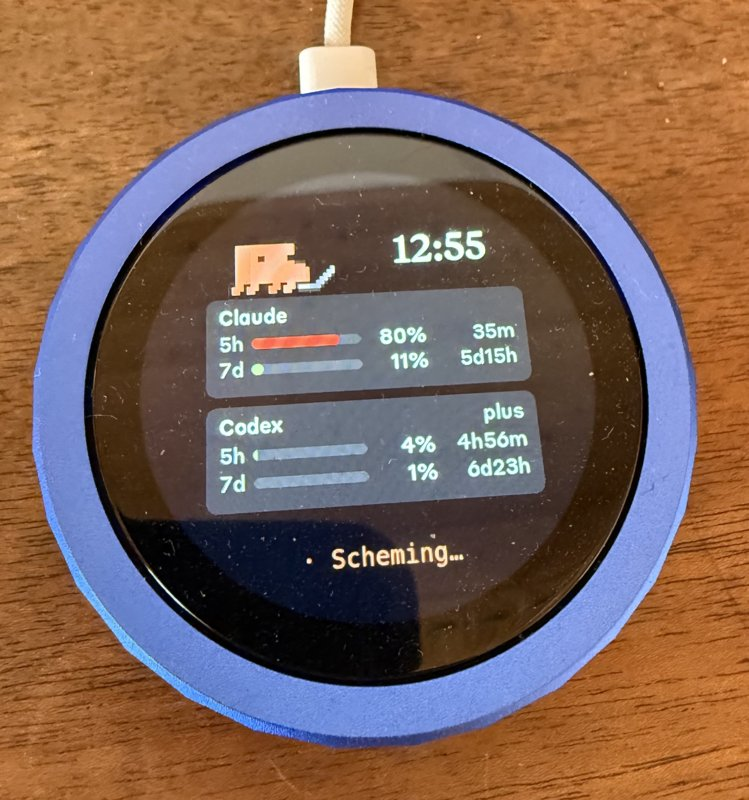

# AI Assistant Knob

**[English](#english) · [Deutsch](#deutsch)**

<a id="english"></a>

A **Waveshare ESP32-S3 Knob-1.8** as a physical control centre for Claude Code, in the CLI and
in the desktop app. The round dial shows your limits and what Claude is doing right now. On it
you answer questions and approvals, switch sessions, set model and reasoning, and dictate
prompts with push-to-talk.

<p align="center"></p>

It builds on [AI_Limitmeter](https://github.com/SirTobi88/AI_Limitmeter), a fork of
[Clawdmeter](https://github.com/HermannBjorgvin/Clawdmeter) by Hermann Björgvin. The Knob-1.8
port, the BLE service, the limit display with Clawd, the simulator and the daemon come from
there. This project turns the display into an input device:

- **Questions and approvals on the knob:** Bash approvals, `AskUserQuestion` and plans show up
  as a ring menu with a pulsing blue border. Turn to choose, tap to confirm. Dangerous options
  (`git push`, `rm -rf`, `sudo` …) only count if you hold until the ring has filled. With no
  answer after 30 s, or with “Am Rechner” (at the computer), the normal dialog takes over.
- **Control sessions:** a list of all running sessions with the titles from the app's sidebar,
  sorted by last activity. A tap also brings the session to the front in the desktop app.
  Model, reasoning, plan mode, fast mode and stop go straight into the session.
- **Voice input:** hold anywhere, for up to 2 minutes, to record through the built-in
  microphone. Whisper transcribes locally on the Mac. You can read the text on the knob and
  send it, discard it, or put it into the session's input box to edit.
- **“Zur Session” (go to session):** when a session reports “needs you” or “your turn”, Clawd
  plays its animation and after 5 s offers a button that jumps straight to that session.
- **Feedback on errors:** if a command doesn't get through, the knob briefly shows why, for
  example “Session wartet auf Eingabe am PC” (session is waiting for input on the computer),
  instead of staying silent.
- **Limits as in the Limitmeter:** Claude and Codex, 5-hour and weekly windows, clock and
  Clawd in the corner. With the plugin, the sessions themselves deliver the Claude values, with
  no API polling of its own.

The knob's user interface is in German; the screenshots and the tables below give the English
meaning.

| Overview | Clawd with “Zur Session” | Main menu | Sessions |
| :---: | :---: | :---: | :---: |
|  |  |  |  |

| Approval | Recording | Transcript | Notice |
| :---: | :---: | :---: | :---: |
|  |  |  |  |

*Screenshots from the simulator (360×360, round like the knob).*

## Controls

| Gesture | Effect |
| --- | --- |
| Turn the ring | open the menu, move the selection |
| Tap | select; on the overview: switch between numbers and Clawd |
| Double tap | back / close |
| Hold | push-to-talk (anywhere); on red options: confirm |

Turning the ring opens the main menu:

| Entry | What happens |
| --- | --- |
| **Fragen** (questions) | open questions and approvals (only when there are any) |
| **Sessions** | pick the active session; the desktop app then shows it too |
| **Modell** (model) | model of the active session |
| **Reasoning** | effort `low` … `max` |
| **Plan-Modus** (plan mode) | sends `/plan`. It goes back to auto when you accept the plan |
| **Monitor** | limits, forecast, context, agents, tasks, diff, CI |
| **Stopp** (stop) | interrupts the running turn (only while Claude is working) |

Without input the menu closes after 30 s and the overview comes back. After 10 min without
input the display turns off (standby). The ring or a touch wakes it, as do a question, “needs
you” and “your turn”. The first touch only wakes it and does nothing else. If a question is
waiting, it opens by itself, wherever you are.

**Voice input:** while you hold, a red dot pulses to the rhythm of your voice and the arc
shows the time (max. 2 min). After you let go, a waiting screen shows that the recording is
being transcribed. Then the text appears in large type, scrollable with the ring. At the
bottom you choose **Senden** (send), **Am PC bearbeiten** (edit on the computer) or
**Verwerfen** (discard). Holding on the text records again.

## Hardware

- [Waveshare ESP32-S3-Knob-Touch-LCD-1.8](https://www.waveshare.com/esp32-s3-knob-touch-lcd-1.8.htm):
  round 360×360 display, rotary ring, touch and PDM microphone.

This project supports no other boards: ring menu, microphone and layout are made for the
knob. The knob has no reachable button, no speaker (line-out only), no noticeable haptics and
no battery gauge. Everything runs through the ring and touch.

## Requirements

- macOS. The bridge uses CoreBluetooth, AppleScript and `open claude://…`.
- [PlatformIO CLI](https://docs.platformio.org/en/latest/core/installation/index.html)
- Python 3.11+ with `bleak` and `httpx`
- Claude Code (CLI or desktop app) with a subscription
- For voice input: `whisper-cpp` (`brew install whisper-cpp`) and a Whisper model
- For model, reasoning and plan mode in the desktop app: the Accessibility permission for the
  app that starts the bridge (System Settings → Privacy & Security → Accessibility)
- Optional, for the Codex values: the Codex CLI (the bridge reads `~/.codex/sessions`)

## Installation

### 1. Get the code and flash the firmware

```bash
git clone https://github.com/SirTobi88/AI_Assistant.git
cd AI_Assistant
pio run -d firmware -e waveshare_knob_18 -t upload
```

### 2. Pair the knob

Open **System Settings → Bluetooth** and click *Connect* next to “AI Knob XXXX”. XXXX are the
last four digits of the Bluetooth address. The bridge only connects to the device the Mac has
paired and doesn't scan for it on its own.

### 3. Set up and start the bridge

```bash
python3 -m venv .venv
.venv/bin/pip install bleak httpx pytest
mkdir -p ~/.config/ai-knob && cp bridge/config.example ~/.config/ai-knob/config
.venv/bin/python -m bridge.claude_usage_daemon
```

Permanently as a LaunchAgent (starts at login, restarts after a crash):

```bash
tools/install_launchagent.sh                # set up and start
tail -F ~/Library/Logs/ai-knob-bridge.out.log
launchctl kickstart -k gui/$(id -u)/com.user.ai-knob-bridge   # after changes to the bridge
tools/install_launchagent.sh --uninstall
```

Under launchd, `.venv/bin/python` itself needs the Accessibility permission (for
`control = keys`); in a terminal it inherits the terminal app's permission. Run only one
bridge at a time: the knob takes a single connection.

The bridge connects to the knob over BLE, accepts the sessions' connections
(`~/.config/ai-knob/mod.sock`) and sends limits, sessions and questions to the knob. If it
isn't running, Claude Code simply shows its normal dialogs.

### 4. Install the `ai-knob` plugin (recommended)

```bash
tools/install_mod.sh               # local marketplace + install for all sessions
tools/install_mod.sh --uninstall   # remove it again
```

Run it from a terminal. New sessions load the plugin right away, running ones after
`/reload-plugins`. The plugin runs in every session, in the CLI as in the desktop app, and
talks to the bridge directly.

After changes to the plugin, the installed copy gets the update like this:

```bash
# first bump "version" in mod/ai-knob/.claude-plugin/plugin.json
claude plugin marketplace update ai-knob-local
claude plugin update ai-knob@ai-knob-local --scope user
```

Then enter `/reload-plugins` in the sessions.

### 5. Allow session control

In `~/.config/ai-knob/config`:

```ini
control = keys
```

Without this line the knob shows everything but changes nothing in the sessions.

### 6. Voice input (optional)

```bash
brew install whisper-cpp
mkdir -p ~/.config/ai-knob/models
curl -L -o ~/.config/ai-knob/models/ggml-large-v3-turbo-q5_0.bin \
  https://huggingface.co/ggerganov/whisper.cpp/resolve/main/ggml-large-v3-turbo-q5_0.bin
```

Transcription defaults to German. For English set `whisper_lang = en` (or `auto`) in the
config; other paths and models via `whisper_cli` and `whisper_model`.

## Configuration

`~/.config/ai-knob/config`. The bridge keeps re-reading the file, no restart needed. All
options with explanations are in [`bridge/config.example`](bridge/config.example).

| Option | Values | Effect |
| --- | --- | --- |
| `control` | `off` · `keys` | control sessions from the knob |
| `screen_mode` | `usage` · `clawd` · `auto` | overview fixed, Clawd fixed, or Clawd large on every new state (6.5 s; 15 s for “needs you” / “your turn”, with “Zur Session”). Default `usage` |
| `corner_buddy` | `on` · `off` | small Clawd in the corner of the overview |
| `state_sounds` | `on` · `off` | sounds on state changes (only audible via line-out) |
| `chime` | `off` · `on` | sound when the 5-hour limit resets |
| `volume` | `0` … `100` | volume of all sounds in percent, default 70 |
| `clock` | `auto` · `12` · `24` · `off` | clock on the overview |
| `desktop_model_ids` | `opus=claude-opus-5-5, …` | full model IDs for the desktop app's `/model` |
| `whisper_cli`, `whisper_model`, `whisper_lang` | paths, language | voice input (language default `de`) |

## How it works

```
 Claude Code session ──(ai-knob plugin, HTTP over Unix socket)──┐
 Claude Code session ──┤                                        │
 Desktop app ◄──(claude:// link, keystrokes, /model /effort /plan)── Bridge (Python) ◄──BLE──► Knob
 whisper-cli ◄──(audio from the knob, transcript back)───────────┘
```

1. **`ai-knob` plugin** (`mod/ai-knob`, TypeScript): reports status, model, effort, context
   and rate limits of each session to the bridge, fetches commands by long poll and forwards
   approvals, questions and plans to the knob. If no answer comes, Claude Code shows its own
   dialog.
2. **Bridge** (`bridge/`, Python): registry of all sessions, protocol v1 to the knob, limits.
   - Limits: only sessions that made a request within the last 5 hours count (older ones
     still report last week's values); among those, the highest use per window counts. Without the
     plugin, the bridge polls the limits from the API itself, like the Limitmeter, using
     Claude Code's token.
   - Control where the plugin itself can't reach (`control.py`):
     - Desktop app: the bridge types the app's own commands `/model`, `/effort` and `/plan`.
       The plugin clears the input box first and restores your draft afterwards.
     - Switching sessions: the bridge opens the session in the app via
       `claude://claude.ai/epitaxy/<id>`.
     - CLI in a terminal: slash commands and Shift+Tab in the session's Terminal.app tab.
   - Voice input (`voice.py`): decode IMA-ADPCM from the knob, transcribe with `whisper-cli`.
3. **Firmware** (`firmware/`, PlatformIO, LVGL 9, NimBLE):
   - Limit display and Clawd from the Limitmeter.
   - On top of that the ring menu (`ringmenu.cpp`) with the views in `app.cpp`.
   - Microphone via I2S/PDM, audio as ADPCM on its own BLE characteristic.

**Without the plugin** there is a fallback via Claude Code hooks:

```bash
.venv/bin/python bridge/knob_activity.py --install    # session status
.venv/bin/python bridge/knob_hook.py --install        # approvals, questions, plans
```

The hooks add themselves to `~/.claude/settings.json`. Other entries stay untouched,
`--uninstall` removes only its own. With the plugin the hooks aren't needed.

What the plugin API can do and what was measured on the real system is documented (in
German) in [`docs/mod-api-findings.md`](docs/mod-api-findings.md).

## BLE protocol

Its own service, separate from the Limitmeter, so both can run side by side:

| | UUID |
| --- | --- |
| Service | `41494b6e-6f62-4272-6964-676500000001` |
| RX (bridge → knob, write) | `…0002` |
| TX (knob → bridge, notify) | `…0003` |
| AUDIO (knob → bridge, notify) | `…0005` |

Messages are JSON with a type `t`, for example `sessions`, `options`, `prompt`, `monitor`,
`stt` and `notice` from the bridge, and `answer`, `switch`, `set`, `interrupt`, `ptt` and
`stt_send` from the knob. Longer messages are sent in chunks. Messages without `t` are the
limit payload from the Limitmeter (`s`, `sr`, `w`, `wr`, `a`, `as`, `cx` …). The full protocol
is in [`docs/protocol.md`](docs/protocol.md) (German).

## Alongside Clawdmeter / AI_Limitmeter

Both run side by side without problems. Everything is separate:
- device name “AI Knob XXXX” and its own service UUID
- configuration and data under `~/.config/ai-knob/`
- its own hook files `knob_activity.py` and `knob_hook.py`

## Development

- **Simulator:** the round 360×360 knob as an SDL2 window. Ring = arrow up/down or mouse
  wheel, click = tap, press and hold = hold.
  ```bash
  pio run -d firmware -e sim && (cd firmware && .pio/build/sim/program)
  ```
  Headless with a screenshot: `SDL_VIDEODRIVER=dummy SIM_AUTOSHOT_MS=5000 .pio/build/sim/program`.
  More control through environment variables:
  - `SIM_SCENARIO=<jsonl>` plays back messages.
  - `SIM_INPUT="1000:d,1600:s,2000:t,3000:h1800"` simulates input.
  - `SIM_MIC_WAV=<16-kHz-WAV>` replaces the microphone.
  - `SIM_SHOT_PREFIX` sets where screenshots go.
- **Virtual knob:** bridge and simulator connected over a Unix socket instead of Bluetooth.
  Same packets, real sessions end up in the simulator:
  ```bash
  tools/virtual_knob.sh              # bridge in virtual mode + simulator window
  tools/virtual_knob.sh --no-usage   # without usage polling
  ```
- **Tests:**
  ```bash
  .venv/bin/python -m pytest bridge/tests -q     # bridge, incl. end-to-end with the simulator
  claude plugin validate mod/ai-knob
  claude plugin test mod/ai-knob                  # plugin
  ```
- **Fonts:** `tools/gen_fonts.py` generates Styrene 12–28 with umlauts (see
  [`docs/fonts.md`](docs/fonts.md)).
- **Project notes:** [`CLAUDE.md`](CLAUDE.md) (German) collects hardware details and
  pitfalls, for example the GATT cache, the sim build and the plugin cache.

## Credits

- [Clawdmeter](https://github.com/HermannBjorgvin/Clawdmeter) by Hermann Björgvin and
  [AI_Limitmeter](https://github.com/SirTobi88/AI_Limitmeter): the basis for firmware, daemon
  and simulator.
- The pixel-art animations of Clawd are Anthropic's official mascot.
- [whisper.cpp](https://github.com/ggerganov/whisper.cpp) for local transcription.
- Lucide icons ([lucide.dev](https://lucide.dev), MIT).
- Anthropic fonts (Tiempos Text, Styrene B), see the note below.

## License note

As in the upstream project: this repository uses Anthropic's proprietary fonts and
copyrighted assets such as the Clawd mascot, without permission. That is why the code has no
license of its own. Anyone forking or reusing code should be aware of this.

---

<a id="deutsch"></a>

# AI Assistant Knob (Deutsch)

Ein **Waveshare ESP32-S3 Knob-1.8** als physische Steuerzentrale für Claude Code, in der CLI
und in der Desktop-App. Der runde Drehregler zeigt die Limits und was Claude gerade tut. Auf
ihm beantwortest du Rückfragen und Freigaben, wechselst Sessions, stellst Modell und Reasoning
ein und sprichst Prompts per Push-to-talk ein.

<p align="center"></p>

Basis ist [AI_Limitmeter](https://github.com/SirTobi88/AI_Limitmeter), ein Fork von
[Clawdmeter](https://github.com/HermannBjorgvin/Clawdmeter) von Hermann Björgvin. Von dort
stammen der Knob-1.8-Port, der BLE-Dienst, die Limit-Anzeige mit Clawd, der Simulator und der
Daemon. Dieses Projekt macht aus der Anzeige ein Eingabegerät:

- **Rückfragen und Freigaben am Knob:** Bash-Freigaben, `AskUserQuestion` und Pläne erscheinen
  als Ring-Menü mit pulsierendem blauem Rahmen. Drehen wählt, Tippen bestätigt. Gefährliche
  Optionen (`git push`, `rm -rf`, `sudo` …) gelten nur, wenn du hältst, bis sich der Ring
  gefüllt hat. Ohne Antwort nach 30 s oder mit „Am Rechner“ übernimmt der normale Dialog.
- **Sessions steuern:** Liste aller laufenden Sessions mit den Titeln aus der App-Sidebar,
  sortiert nach letzter Aktivität. Ein Tipp holt die Session auch in der Desktop-App nach vorn.
  Modell, Reasoning, Plan-Modus, Fast und Stopp gehen direkt in die Session.
- **Spracheingabe:** Halten, überall und bis zu 2 Minuten, nimmt über das eingebaute Mikrofon
  auf. Whisper transkribiert lokal auf dem Mac. Der Text lässt sich am Knob lesen und abschicken,
  verwerfen oder zum Bearbeiten ins Eingabefeld der Session legen.
- **„Zur Session“:** Meldet eine Session „needs you“ oder „your turn“, spielt Clawd die
  Animation und bietet nach 5 s einen Button an, der direkt in diese Session springt.
- **Rückmeldung bei Fehlern:** Kommt ein Befehl nicht an, zeigt der Knob kurz, warum, zum
  Beispiel „Session wartet auf Eingabe am PC“, statt stumm zu bleiben.
- **Limits wie beim Limitmeter:** Claude und Codex, 5-Stunden- und Wochenfenster, Uhr und Clawd
  in der Ecke. Mit dem Plugin liefern die Sessions die Claude-Werte selbst, ohne eigene
  API-Abfrage.

| Übersicht | Clawd mit „Zur Session“ | Hauptmenü | Sessions |
| :---: | :---: | :---: | :---: |
|  |  |  |  |

| Freigabe | Aufnahme | Transkript | Hinweis |
| :---: | :---: | :---: | :---: |
|  |  |  |  |

*Screenshots aus dem Simulator (360×360, rund wie der Knob).*

## Bedienung

| Geste | Wirkung |
| --- | --- |
| Ring drehen | Menü öffnen, Auswahl bewegen |
| Tippen | auswählen; auf der Übersicht: zwischen Zahlen und Clawd wechseln |
| Doppeltippen | zurück bzw. schließen |
| Halten | Push-to-talk (überall); bei roten Optionen: bestätigen |

Das Hauptmenü öffnest du durch Drehen am Ring:

| Eintrag | Was passiert |
| --- | --- |
| **Fragen** | offene Rückfragen und Freigaben (nur wenn welche da sind) |
| **Sessions** | aktive Session wählen; die Desktop-App zeigt sie dann auch |
| **Modell** | Modell der aktiven Session |
| **Reasoning** | Effort `low` … `max` |
| **Plan-Modus** | schickt `/plan`. Zurück auf Auto geht es beim Annehmen des Plans |
| **Monitor** | Limits, Prognose, Kontext, Agents, Tasks, Diff, CI |
| **Stopp** | bricht den laufenden Turn ab (nur während Claude arbeitet) |

Ohne Eingabe schließt sich das Menü nach 30 s und die Übersicht kommt zurück. Nach 10 min ohne
Eingabe geht das Display aus (Standby). Ring oder Touch wecken es, ebenso eine Frage, „needs you“
und „your turn“. Die erste Berührung weckt nur und löst sonst nichts aus. Liegt eine Frage
an, öffnet sie sich von selbst, egal wo du gerade bist.

**Spracheingabe:** Solange du hältst, pulsiert ein roter Punkt im Rhythmus deiner Stimme, und
der Bogen zeigt die Zeit (max. 2 min). Nach dem Loslassen zeigt ein Wartebildschirm, dass
transkribiert wird. Danach erscheint der Text in großer Schrift, mit dem Ring scrollbar. Unten
wählst du **Senden**, **Am PC bearbeiten** oder **Verwerfen**. Halten auf dem Text nimmt neu auf.

## Hardware

- [Waveshare ESP32-S3-Knob-Touch-LCD-1.8](https://www.waveshare.com/esp32-s3-knob-touch-lcd-1.8.htm):
  rundes 360×360-Display, Drehring, Touch und PDM-Mikrofon.

Andere Boards unterstützt dieses Projekt nicht: Ring-Menü, Mikrofon und Layout sind auf den
Knob zugeschnitten. Der Knob hat keine erreichbare Taste, keinen Lautsprecher (nur Line-out),
keine spürbare Haptik und keine Akkuanzeige. Alles läuft über Ring und Touch.

## Voraussetzungen

- macOS. Die Bridge nutzt CoreBluetooth, AppleScript und `open claude://…`.
- [PlatformIO CLI](https://docs.platformio.org/en/latest/core/installation/index.html)
- Python 3.11+ mit `bleak` und `httpx`
- Claude Code (CLI oder Desktop-App) mit Abo
- Für die Spracheingabe: `whisper-cpp` (`brew install whisper-cpp`) und ein Whisper-Modell
- Für Modell, Reasoning und Plan-Modus in der Desktop-App: das Recht „Bedienungshilfen“ für die
  App, die die Bridge startet (Systemeinstellungen → Datenschutz & Sicherheit → Bedienungshilfen)
- Optional, für die Codex-Werte: die Codex-CLI (die Bridge liest `~/.codex/sessions`)

## Installation

### 1. Code holen und Firmware flashen

```bash
git clone https://github.com/SirTobi88/AI_Assistant.git
cd AI_Assistant
pio run -d firmware -e waveshare_knob_18 -t upload
```

### 2. Knob koppeln

**Systemeinstellungen → Bluetooth** öffnen und bei „AI Knob XXXX“ auf *Verbinden* klicken.
XXXX sind die letzten vier Stellen der Bluetooth-Adresse. Die Bridge verbindet sich nur mit dem
Gerät, das der Mac gekoppelt hat, und sucht nicht selbst danach.

### 3. Bridge einrichten und starten

```bash
python3 -m venv .venv
.venv/bin/pip install bleak httpx pytest
mkdir -p ~/.config/ai-knob && cp bridge/config.example ~/.config/ai-knob/config
.venv/bin/python -m bridge.claude_usage_daemon
```

Dauerhaft als LaunchAgent (startet beim Anmelden, nach einem Absturz neu):

```bash
tools/install_launchagent.sh                # einrichten und starten
tail -F ~/Library/Logs/ai-knob-bridge.out.log
launchctl kickstart -k gui/$(id -u)/com.user.ai-knob-bridge   # nach Änderungen an der Bridge
tools/install_launchagent.sh --uninstall
```

Unter launchd braucht `.venv/bin/python` selbst das Recht „Bedienungshilfen“ (für
`control = keys`); im Terminal erbt es das Recht der Terminal-App. Es darf nur eine Bridge
laufen: Der Knob nimmt nur eine Verbindung an.

Die Bridge verbindet sich per BLE mit dem Knob, nimmt die Verbindungen der Sessions entgegen
(`~/.config/ai-knob/mod.sock`) und schickt Limits, Sessions und Fragen an den Knob. Läuft sie
nicht, zeigt Claude Code einfach seine normalen Dialoge.

### 4. Plugin `ai-knob` installieren (empfohlen)

```bash
tools/install_mod.sh               # lokaler Marketplace + Installation für alle Sessions
tools/install_mod.sh --uninstall   # wieder entfernen
```

Im Terminal ausführen. Neue Sessions laden das Plugin sofort, laufende nach `/reload-plugins`.
Das Plugin läuft in jeder Session, in der CLI wie in der Desktop-App, und spricht direkt mit der
Bridge.

Nach Änderungen am Plugin bekommt die installierte Kopie das Update so:

```bash
# zuerst "version" in mod/ai-knob/.claude-plugin/plugin.json erhöhen
claude plugin marketplace update ai-knob-local
claude plugin update ai-knob@ai-knob-local --scope user
```

Danach in den Sessions `/reload-plugins` eingeben.

### 5. Sessions steuern erlauben

In `~/.config/ai-knob/config`:

```ini
control = keys
```

Ohne diese Zeile zeigt der Knob alles an, ändert aber nichts an den Sessions.

### 6. Spracheingabe (optional)

```bash
brew install whisper-cpp
mkdir -p ~/.config/ai-knob/models
curl -L -o ~/.config/ai-knob/models/ggml-large-v3-turbo-q5_0.bin \
  https://huggingface.co/ggerganov/whisper.cpp/resolve/main/ggml-large-v3-turbo-q5_0.bin
```

Andere Pfade, Modelle oder Sprachen stellst du in der Konfiguration ein: `whisper_cli`,
`whisper_model`, `whisper_lang` (Voreinstellung `de`).

## Konfiguration

`~/.config/ai-knob/config`. Die Bridge liest die Datei laufend neu ein, ein Neustart ist nicht
nötig. Alle Optionen mit Erklärung stehen in [`bridge/config.example`](bridge/config.example).

| Option | Werte | Wirkung |
| --- | --- | --- |
| `control` | `off` · `keys` | Sessions vom Knob aus steuern |
| `screen_mode` | `usage` · `clawd` · `auto` | Übersicht fest, Clawd fest, oder Clawd groß bei jedem neuen Zustand (6,5 s; bei „needs you“ / „your turn“ 15 s, mit „Zur Session“). Voreinstellung `usage` |
| `corner_buddy` | `on` · `off` | Clawd klein in der Ecke der Übersicht |
| `state_sounds` | `on` · `off` | Töne bei Zustandswechseln (nur über Line-out hörbar) |
| `chime` | `off` · `on` | Ton, wenn das 5-Stunden-Limit zurückgesetzt wird |
| `volume` | `0` … `100` | Lautstärke aller Töne in Prozent, Voreinstellung 70 |
| `clock` | `auto` · `12` · `24` · `off` | Uhr auf der Übersicht |
| `desktop_model_ids` | `opus=claude-opus-5-5, …` | volle Modell-IDs für das `/model` der Desktop-App |
| `whisper_cli`, `whisper_model`, `whisper_lang` | Pfade, Sprache | Spracheingabe (Sprache standardmäßig `de`) |

## Wie es funktioniert

```
 Claude Code Session ──(Plugin ai-knob, HTTP über Unix-Socket)──┐
 Claude Code Session ──┤                                        │
 Desktop-App ◄──(claude://-Link, Tastendrücke, /model /effort /plan)── Bridge (Python) ◄──BLE──► Knob
 whisper-cli ◄──(Audio vom Knob, Transkript zurück)──────────────┘
```

1. **Plugin `ai-knob`** (`mod/ai-knob`, TypeScript): meldet Status, Modell, Effort, Kontext und
   Rate-Limits jeder Session an die Bridge, holt Befehle per Long-Poll ab und leitet Freigaben,
   Fragen und Pläne an den Knob weiter. Kommt keine Antwort, zeigt Claude Code seinen eigenen
   Dialog.
2. **Bridge** (`bridge/`, Python): Registry aller Sessions, Protokoll v1 zum Knob, Limits.
   - Limits: Es zählen nur Sessions, die in den letzten 5 Stunden etwas angefragt haben
     (ältere melden noch Werte der Vorwoche); unter diesen zählt pro Fenster der höchste Wert. Ohne Plugin
     fragt die Bridge die Limits wie das Limitmeter selbst bei der API ab, mit dem Token von
     Claude Code.
   - Steuerung, wo das Plugin selbst nicht hinkommt (`control.py`):
     - Desktop-App: Die Bridge tippt die app-eigenen Befehle `/model`, `/effort` und `/plan`.
       Das Plugin leert vorher das Eingabefeld und stellt deinen Entwurf danach wieder her.
     - Session wechseln: Die Bridge öffnet die Session in der App über
       `claude://claude.ai/epitaxy/<id>`.
     - CLI im Terminal: Slash-Commands und Shift+Tab im Terminal.app-Tab der Session.
   - Spracheingabe (`voice.py`): IMA-ADPCM vom Knob dekodieren, mit `whisper-cli` transkribieren.
3. **Firmware** (`firmware/`, PlatformIO, LVGL 9, NimBLE):
   - Limit-Anzeige und Clawd aus dem Limitmeter.
   - Darüber das Ring-Menü (`ringmenu.cpp`) mit den Ansichten in `app.cpp`.
   - Mikrofon über I2S/PDM, Audio als ADPCM auf eigenem BLE-Merkmal.

**Ohne Plugin** gibt es einen Rückfall über Claude-Code-Hooks:

```bash
.venv/bin/python bridge/knob_activity.py --install    # Status der Sessions
.venv/bin/python bridge/knob_hook.py --install        # Freigaben, Fragen, Pläne
```

Die Hooks tragen sich in `~/.claude/settings.json` ein. Fremde Einträge bleiben unberührt,
`--uninstall` entfernt nur die eigenen. Mit Plugin sind die Hooks nicht nötig.

Was die Plugin-API kann und was am echten System gemessen wurde, steht in
[`docs/mod-api-findings.md`](docs/mod-api-findings.md).

## BLE-Protokoll

Eigener Dienst, getrennt vom Limitmeter, damit beide parallel laufen können:

| | UUID |
| --- | --- |
| Dienst | `41494b6e-6f62-4272-6964-676500000001` |
| RX (Bridge → Knob, write) | `…0002` |
| TX (Knob → Bridge, notify) | `…0003` |
| AUDIO (Knob → Bridge, notify) | `…0005` |

Nachrichten sind JSON mit Typ `t`, zum Beispiel `sessions`, `options`, `prompt`, `monitor`,
`stt` und `notice` von der Bridge, `answer`, `switch`, `set`, `interrupt`, `ptt` und `stt_send`
vom Knob. Längere Nachrichten werden gestückelt übertragen. Nachrichten ohne `t` sind die
Limit-Payload aus dem Limitmeter (`s`, `sr`, `w`, `wr`, `a`, `as`, `cx` …). Das vollständige
Protokoll steht in [`docs/protocol.md`](docs/protocol.md).

## Neben Clawdmeter / AI_Limitmeter

Beide laufen problemlos parallel. Alles ist getrennt:
- Gerätename „AI Knob XXXX“ und eigene Service-UUID
- Konfiguration und Daten unter `~/.config/ai-knob/`
- eigene Hook-Dateien `knob_activity.py` und `knob_hook.py`

## Entwicklung

- **Simulator:** Der runde 360×360-Knob als SDL2-Fenster. Ring = Pfeil hoch/runter oder
  Mausrad, Klick = Tippen, gedrückt halten = Halten.
  ```bash
  pio run -d firmware -e sim && (cd firmware && .pio/build/sim/program)
  ```
  Ohne Fenster mit Screenshot: `SDL_VIDEODRIVER=dummy SIM_AUTOSHOT_MS=5000 .pio/build/sim/program`.
  Weitere Steuerung über Umgebungsvariablen:
  - `SIM_SCENARIO=<jsonl>` spielt Nachrichten ab.
  - `SIM_INPUT="1000:d,1600:s,2000:t,3000:h1800"` simuliert Eingaben.
  - `SIM_MIC_WAV=<16-kHz-WAV>` ersetzt das Mikrofon.
  - `SIM_SHOT_PREFIX` legt fest, wo Screenshots landen.
- **Virtueller Knob:** Bridge und Simulator verbunden über einen Unix-Socket statt Bluetooth.
  Dieselben Pakete, echte Sessions landen im Simulator:
  ```bash
  tools/virtual_knob.sh              # Bridge im virtuellen Modus + Simulator-Fenster
  tools/virtual_knob.sh --no-usage   # ohne Usage-Abfrage
  ```
- **Tests:**
  ```bash
  .venv/bin/python -m pytest bridge/tests -q     # Bridge, inkl. End-to-End mit dem Simulator
  claude plugin validate mod/ai-knob
  claude plugin test mod/ai-knob                  # Plugin
  ```
- **Schriften:** `tools/gen_fonts.py` erzeugt Styrene 12–28 mit Umlauten (siehe
  [`docs/fonts.md`](docs/fonts.md)).
- **Projektnotizen:** [`CLAUDE.md`](CLAUDE.md) sammelt Hardware-Details und
  Stolpersteine, zum Beispiel GATT-Cache, Sim-Build und Plugin-Cache.

## Credits

- [Clawdmeter](https://github.com/HermannBjorgvin/Clawdmeter) von Hermann Björgvin und
  [AI_Limitmeter](https://github.com/SirTobi88/AI_Limitmeter): Grundlage für Firmware, Daemon
  und Simulator.
- Die Pixel-Art-Animationen von Clawd sind das offizielle Maskottchen von Anthropic.
- [whisper.cpp](https://github.com/ggerganov/whisper.cpp) für die lokale Transkription.
- Lucide-Icons ([lucide.dev](https://lucide.dev), MIT).
- Anthropic-Schriften (Tiempos Text, Styrene B), siehe Hinweis unten.

## Hinweis zur Lizenz

Wie beim Upstream-Projekt: Dieses Repository nutzt die proprietären Schriften von Anthropic und
urheberrechtlich geschützte Assets wie das Clawd-Maskottchen, ohne Erlaubnis. Deshalb steht der
Code unter keiner eigenen Lizenz. Wer forkt oder Code übernimmt, sollte das wissen.
